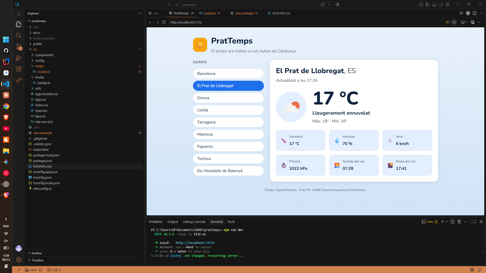

# PratTemps

PratTemps mostra el temps actual d’una de vuit ciutats de Catalunya. Les dades provenen de l’API Current Weather d’OpenWeather i es presenten amb informació com la temperatura, la humitat, el vent i les hores de sortida i posta del sol.

## Captura



La captura encara no està inclosa. Desa una imatge de la web amb el nom `captura.png` dins de la carpeta `docs`.

## Com executar el projecte

1. Clona el repositori i entra a la carpeta:

   ```bash
   git clone https://github.com/wisbhr107/prattemps.git
   cd prattemps
   ```

2. Instal·la les dependències:

   ```bash
   npm install
   ```

3. Copia `.env.example` a `.env` (a PowerShell, fes servir `Copy-Item .env.example .env`). Obre `.env` i escriu la teva clau d’OpenWeather després de `VITE_OWM_KEY=`.

4. Inicia el servidor de desenvolupament:

   ```bash
   npm run dev
   ```

   Obre al navegador l’adreça local que indiqui Vite. Si encara no has afegit una clau vàlida, l’aplicació mostrarà un avís i no consultarà l’API.

## Eines d'interfície natural

| Eina | Què fa | Com es podria fer servir a PratTemps |
|---|---|---|
| Web Speech API (reconeixement de veu) | Escolta unes paraules i les transforma en text. | L’usuari podria dir el nom d’una ciutat per seleccionar-la sense buscar-la a la llista. |
| MediaPipe (seguiment de mans i gestos amb la càmera) | Reconeix la posició de la mà i alguns gestos mentre la càmera està activa. | Un gest cap a l’esquerra o la dreta podria canviar a la ciutat anterior o següent. |
| TensorFlow.js o ml5.js (models d’aprenentatge automàtic al navegador) | Permet executar al navegador un model que troba patrons en dades. | Amb dades del temps i exemples d’indumentària, podria suggerir si convé dur una jaqueta o un paraigua. |
